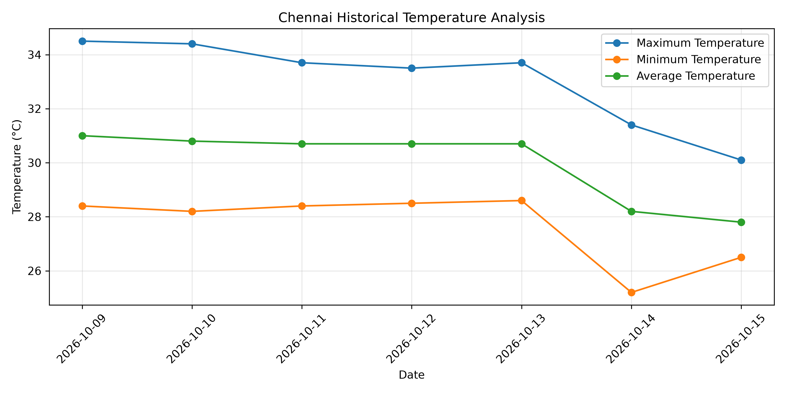

# 🌦️ Weather Data Analysis

A Python project that collects, analyzes, and visualizes current and historical weather data using the Open-Meteo API.

## 📌 Project Overview

This project explores weather patterns in Chennai, India, using Python. It retrieves live weather measurements and historical daily weather records, stores the data in CSV files, and visualizes temperature trends.

## ✨ Features

- 🌡️ Fetch current temperature, feels-like temperature, humidity, and wind speed.
- 📅 Retrieve historical daily maximum, minimum, and mean temperatures.
- 🌧️ Collect daily precipitation data.
- 📊 Visualize temperature trends using Matplotlib.
- 💾 Export weather data to CSV files.

## 🛠️ Technologies Used

- Python
- Requests
- Pandas
- Matplotlib
- Open-Meteo API

## 📂 Project Structure

```text
weather-data-analysis/
├── main.py
├── requirements.txt
├── weather_data.csv
├── historical_weather.csv
├── temperature_trend.png
└── README.md
```

## 🚀 Getting Started

### 1. Install Python

Install Python 3 if it is not already installed.

### 2. Install dependencies

```bash
python -m pip install -r requirements.txt
```

On Windows, you can also use:

```bash
py -m pip install -r requirements.txt
```

### 3. Run the project

Run the Python script from the project folder:

```bash
python main.py
```

On Windows, you can use `py main.py`.

The program retrieves weather data and saves the resulting CSV files and temperature chart, depending on the script version you run.

## 📊 Sample Output

The project generates a temperature trend chart named `temperature_trend.png`, showing historical maximum, minimum, and mean temperatures.



## 🌐 Data Source

Weather data is provided by [Open-Meteo](https://open-meteo.com/). Please refer to its documentation and attribution requirements when using or redistributing the data.

- [Historical Weather API](https://open-meteo.com/en/docs/historical-weather-api)
- [Forecast API](https://open-meteo.com/en/docs)

## 🎯 Learning Outcomes

- Working with REST APIs in Python
- Cleaning and organizing data with Pandas
- Saving data in CSV format
- Creating visualizations with Matplotlib
- Building and documenting a data analysis project

## 👨‍💻 Author

**Prajeeth M.**

- GitHub: [@prajeethm27](https://github.com/prajeethm27)

---

*Built as a beginner-friendly Python data analysis project.*
